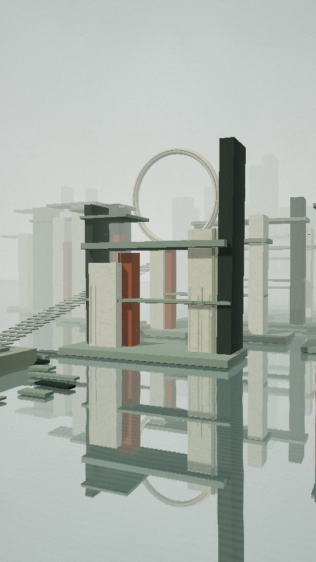

# 无垠庭院 · STILL

由 TypeScript 与 Three.js 创建的巨大建筑空间，灵感来自提供的灰绿、粉白与赭红色画作。

- [下载竖屏视频（MP4）](https://github.com/hhh123-T/image-hosting/raw/refs/heads/main/previews/endless-courtyard-portrait.mp4)
- [查看视频文件](previews/endless-courtyard-portrait.mp4)
- [下载 TypeScript 源码 ZIP](https://github.com/hhh123-T/image-hosting/raw/refs/heads/main/previews/endless-courtyard-typescript.zip)

视频：48 秒，540 × 960，12 fps，H.264，约 21 MB，无音轨，可自行配乐。

解压源码 ZIP 后，请按照其中 README.md 的说明运行。
