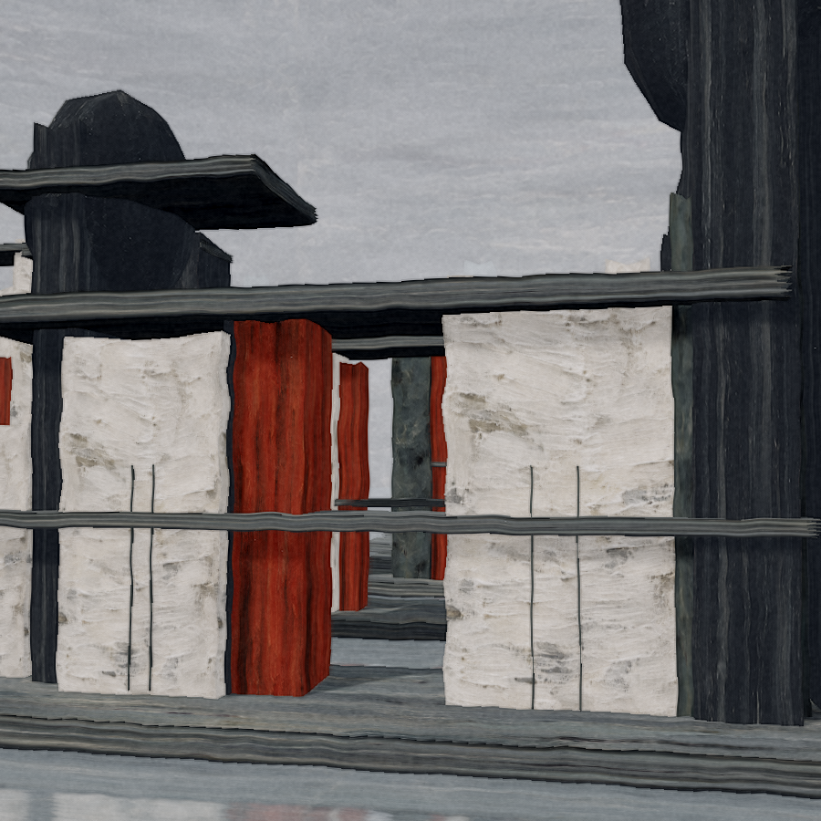

# STILL · 无垠庭院

[下载第二版竖屏视频（48 秒 MP4）](https://github.com/hhh123-T/image-hosting/raw/refs/heads/main/previews/endless-courtyard-painterly-v2.mp4) · [下载源码 ZIP](https://github.com/hhh123-T/image-hosting/raw/refs/heads/main/previews/endless-courtyard-typescript-v2.zip)



以用户提供的画作为视觉参考的 TypeScript / Three.js 三维空间原型。灰蓝平台、粉白墙体、炭黑岩体与赭红切面延伸成一座水上的巨大庭院。第二版强调原画的厚涂刮擦、干刷、水墨倒影和冷灰光影；镜头接近墙面、穿行门廊，再环绕主体。

## 运行

需要 Node.js 22.12+（当前云环境为 Node.js 24）。

```bash
cd /workspace/image-hosting
npm ci --cache /workspace/.cache/npm
npm run dev -- --host 0.0.0.0
```

开发端口默认是 5173。普通本地环境也可以直接 `npm ci`，无需指定云环境缓存目录。

## 操作

- 48 秒连续自动运镜：水上接近 → 穿行庭院 → 抬升 → 环绕 → 返回。
- 播放 / 暂停、进度拖动、从头播放、0.5× / 1× / 1.5× 速度。
- 自动运镜 / 静观庭院 / 云上俯瞰三种视角。
- 9:16 竖屏取景、全屏、纯画面模式。
- `Space` 播放 / 暂停，`C` 纯画面，`Esc` 返回。编辑输入和选择框时不抢占快捷键。
- 尊重系统减少动态效果偏好，开启时初始暂停。隐藏标签页不推进镜头时间。

作品使用真实三维几何、参照原画生成的颜料贴图与程序绘画渲染。纹理附着于各个面的几何，转动镜头仍然有笔触，没有将原画当成平面背景贴图。贴图加载失败时会使用程序生成的备用材质。浏览器需要 WebGL 2，推荐开启硬件加速。

## 验证

```bash
npm test
npm run test:e2e
npm run build
```

浏览器检查默认使用 `/usr/bin/chromium`。其他系统通过 `CHROMIUM_PATH` 指定已有 Chromium/Chrome 的完整路径。检查包括真实 WebGL 渲染、播放状态、画幅切换、快捷键、无 WebGL 的恢复提示、减少动态效果与整条镜头路径的建筑碰撞。

## 效果输出

先保持开发服务器运行：

```bash
node scripts/capture-study.mjs
node scripts/render-video.mjs
```

截图和竖屏 MP4 默认保存到 `/workspace/artifacts/endless-courtyard-v2`。可设置 `COURTYARD_ARTIFACTS` 改变输出目录，`COURTYARD_URL` 改变服务器地址。

视频脚本需要 FFmpeg，直接采样浏览器中的真实 3D 场景，生成 48 秒无声循环。默认 720×1280、24 fps 的竖屏预览；需要更高质量时：

```bash
COURTYARD_WIDTH=1080 COURTYARD_HEIGHT=1920 COURTYARD_FPS=30 node scripts/render-video.mjs
```

这会显著增加渲染时间。当前原型没有内置配乐或浏览器视频导出按钮；生成的 MP4 可以进入剪辑软件继续配乐。

## 结构

- `src/scene/camera-path.ts`：闭合运镜曲线与镜头段落。
- `src/playback.ts`：时间、暂停、速度与进度状态。
- `src/scene/materials.ts`：颜料贴图与备用笔触材质。
- `public/textures/paint-atlas.png`：参照原画生成的粉白、灰蓝、炭黑、赭红材质样本。
- `src/scene/paint-pass.ts`：沿轮廓刷痕、纸纹与颜料边缘渲染。
- `src/scene/world.ts`：建筑、炭黑岩体、雾与灯光。
- `src/scene/water.ts`：水墨倒影、干刷纹理与循环涟漪。
- `src/scene/experience.ts`：渲染与生命周期。
- `src/main.ts`、`src/style.css`：界面、播放控制与响应式取景。

云任务已有隔离环境，直接使用当前 checkout，无需另建 Git worktree。
