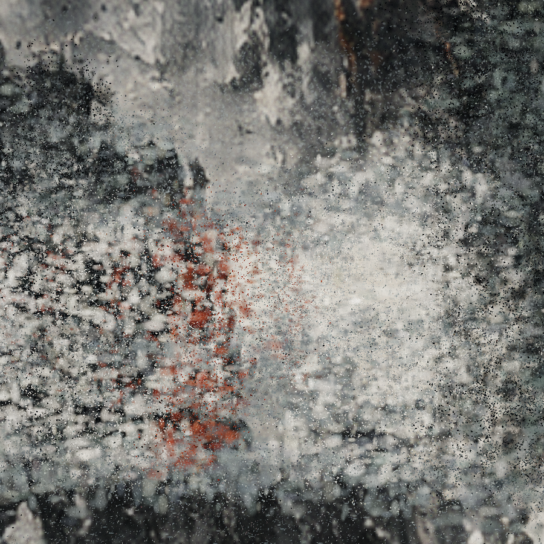

# STILL · 无垠庭院

[下载第三版粒子视频（48 秒 MP4）](https://github.com/hhh123-T/image-hosting/raw/refs/heads/main/previews/endless-courtyard-particles-v3.mp4) · [下载源码 ZIP](https://github.com/hhh123-T/image-hosting/raw/refs/heads/main/previews/endless-courtyard-typescript-v3.zip)



以用户提供的画作为视觉参考的 TypeScript / Three.js 三维空间原型。第三版把灰蓝横向笔触、粉白色块、炭黑墨团和赭红切面转为有厚度的颜料粒子群，边缘卷动、聚散，镜头穿行后再环绕。全景厚涂底色和立体环境粒子围绕整个空间，远景保持灰蓝、粉白和炭黑的颜料层次。

保留[第二版视频](https://github.com/hhh123-T/image-hosting/raw/refs/heads/main/previews/endless-courtyard-painterly-v2.mp4)和[第二版源码](https://github.com/hhh123-T/image-hosting/raw/refs/heads/main/previews/endless-courtyard-typescript-v2.zip)，方便比较。

## 运行

需要 Node.js 22.12+（当前云环境为 Node.js 24）。

```bash
cd /workspace/image-hosting
npm ci --cache /workspace/.cache/npm
npm run dev -- --host 0.0.0.0
```

开发端口默认是 5173。普通本地环境也可以直接 `npm ci`，无需指定云环境缓存目录。

## 操作

- 48 秒连续自动运镜：水上接近 → 穿行庭院 → 抬升 → 环绕 → 返回。
- 播放 / 暂停、进度拖动、从头播放、0.5× / 1× / 1.5× 速度。
- 自动运镜 / 静观庭院 / 云上俯瞰三种视角。
- 9:16 竖屏取景、全屏、纯画面模式。
- `Space` 播放 / 暂停，`C` 纯画面，`Esc` 返回。编辑输入和选择框时不抢占快捷键。
- 尊重系统减少动态效果偏好，开启时初始暂停。隐藏标签页不推进镜头时间。

主体由实际三维点群渲染，建筑几何仅作为不可见的采样骨架。点的颜色读取参照原画生成的颜料样本；柔和笔触点群、细颗粒、粒子倒影与水上点阵形成层次。360 度背景全景参照同一组颜料样本生成，围绕三维空间；它并非原画像素的三维重建。

共 328,500 个独立点；倒影共享主体几何，提交点顶点上限为 548,500。颜料样本加载失败时使用程序材质；全景加载独立于主体，失败时使用程序晕染，完成时也会刷新暂停画面。浏览器需要 WebGL 2，推荐开启硬件加速。

## 验证

```bash
npm test
npm run test:e2e
npm run build
```

浏览器检查默认使用 `/usr/bin/chromium`。其他系统通过 `CHROMIUM_PATH` 指定已有 Chromium/Chrome 的完整路径。检查包括真实 WebGL 渲染、播放状态、画幅切换、快捷键、恢复提示、减少动态效果、镜头路径碰撞、颜料采样接缝、主体仅显示粒子、纹理失败备用效果，以及背景延迟加载时的暂停刷新。

## 效果输出

先保持开发服务器运行：

```bash
node scripts/capture-study.mjs
node scripts/render-video.mjs
```

截图和竖屏 MP4 默认保存到 `/workspace/artifacts/endless-courtyard-v3`。可设置 `COURTYARD_ARTIFACTS` 改变输出目录，`COURTYARD_URL` 改变服务器地址。截图默认检查方形和竖屏的八个时刻；`COURTYARD_TIMES` 可指定逗号分隔的取样时间。

视频脚本需要 FFmpeg，直接采样浏览器中的真实 3D 场景，生成 48 秒无声循环。默认 720×1280、24 fps 的竖屏预览；需要更高质量时：

```bash
COURTYARD_WIDTH=1080 COURTYARD_HEIGHT=1920 COURTYARD_FPS=30 node scripts/render-video.mjs
```

这会显著增加渲染时间。当前原型没有内置配乐或浏览器视频导出按钮；生成的 MP4 可以进入剪辑软件继续配乐。

## 结构

- `src/scene/camera-path.ts`：闭合运镜曲线与镜头段落。
- `src/playback.ts`：时间、暂停、速度与进度状态。
- `src/scene/materials.ts`：颜料贴图与备用笔触材质。
- `public/textures/paint-atlas.png`：参照原画生成的粉白、灰蓝、炭黑、赭红材质样本。
- `public/textures/ink-panorama.png`：参照颜料样本生成的环绕厚涂背景。
- `src/scene/particle-paint.ts`：立体颜料采样、笔触云、环境粒子、水上点阵与粒子倒影。
- `src/scene/particle-grade.ts`：轻量柔光、纸纹与颜色处理。
- `src/scene/world.ts`：不可见空间骨架、环绕背景与资源管理。
- `src/scene/experience.ts`：渲染与生命周期。
- `src/main.ts`、`src/style.css`：界面、播放控制与响应式取景。

云任务已有隔离环境，直接使用当前 checkout，无需另建 Git worktree。
